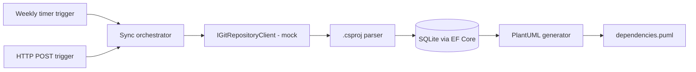

# Engineering Insights Platform

An extensible platform engine for engineering governance. Built with .NET 10, EF Core, and Azure Functions, featuring a cross git repository .NET dependency graph generator.

## Interpretation of the problem

Engineering knowledge is fragmented across repositories, pipelines and platform APIs. Before leaders can answer questions about reliability, risk or trends, they need a trustworthy map of who owns what and how components are coupled. Ownership and dependencies are the foundation for all later operational insights.

## MVP

An Azure Functions app that scans repositories, extracts '.csproj' package consumption and published package identity, stores the results in SQLite and emits a PlantUML (.puml) graph.

- A weekly timer trigger performs an organization-wide sweep.
- an HTTP POST endpoint refreshes a single repository on demand.
- Repository data comes from a deterministic mock Git client (mocked); no real platform is called yet.

## Scope and rationale

The scope for this MVP is limited to repository inventory, team ownership and cross-repository dependencies. The initial focus of this MVP is on .NET applications and packages only.
This is the mandatory first step: failure trends or deployment frequency cannot be attributed accurately without knowing owners and coupling. Other focus areas (workflows, security) are deliberately deferred.

## Architecture and data flow

**Data flow**

1. A trigger starts a sync: the timer covers all repositories, the HTTP call a single `repositoryName`.
2. The orchestrator fetches repository files and the owning team through `IGitRepositoryClient`.
3. The parser extracts consumed packages (`PackageReference`) and the published package identity (`PackageId`, defaulting to the project file name).
4. The dependencies are stored per repository, with owner team, in SQLite.
5. The PlantUML generator reads the database and writes `dependencies.puml`.

**Projects**

| Project | Responsibility |
| --- | --- |
| `EngineeringInsights.WorkerApp` | Azure Functions host with the triggers |
| `EngineeringInsights.DependencyAnalyzer` | Parsing, sync orchestration and PlantUML generation |
| `EngineeringInsights.Dal` | EF Core `DbContext`, migrations and table models |
| `EngineeringInsights.GitRepositoryClient` | `IGitRepositoryClient` interface and the mock implementation |

## Decisions, alternatives and trade-offs

Key choices:

- A flat relational schema over a document or graph based database
- SQLite for a zero-setup MVP
- A abstracted git client interface so a real GitHub or Azure DevOps implementation can replace the mock.
- Scheduled sweeps are combined with on-demand refresh instead of full event-driven collection.
- No authentication was setup on the Function App, as it is beyond the scope of the MVP

## Evolution beyond the MVP

- Replace the mock git client with a real platform client
- move to a production database
- add event-driven ingestion (webhooks)
- The WorkerApp function app is a plug-and-play engine: new modules (e.g. a `WorkflowAnalyzer` or `SecurityScanner`) can be added as separate domain projects and make use of the same database and shared services.
