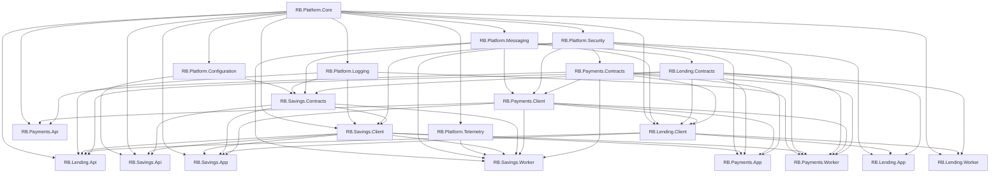
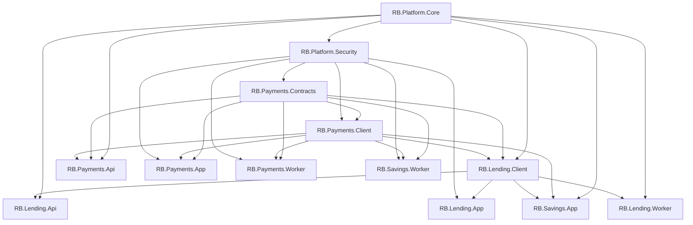
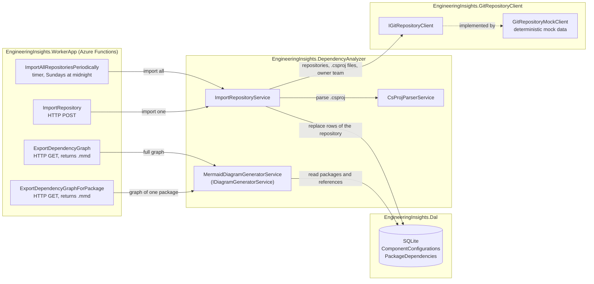

# Engineering Insights Platform

An extensible platform engine for engineering governance. Built with .NET 10, EF Core, and Azure Functions, featuring a cross git repository .NET dependency graph generator.

## MVP

An Azure Functions app that scans repositories, extracts '.csproj' package consumption and published package identity, stores the results in SQLite and emits a Mermaid (.mmd) graph, which can be rendered by open source tooling.

- A weekly timer trigger performs an organization-wide sweep.
- An HTTP POST endpoint refreshes a single repository on demand.
- Two HTTP GET endpoints export the dependency graph of all packages, or of a single package, as a Mermaid (.mmd) file.
- Repository data comes from a deterministic mock Git client (mocked); no real platform is called yet.

## Example output

The result of `GET /api/export-dependency-graph` on the mock data. Arrows point from a package to the packages that use it: platform packages (`RB.Platform.*`) are used by everyone, the shared `Client` and `Contracts` packages by their own applications and other teams, and the applications (`Api`, `App`, `Worker`) are not used by anything.



The same for a single package, `GET /api/export-dependency-graph-for-package/RB.Payments.Contracts`: only that package, everything it depends on and everything that depends on it will be shown.



## Interpretation of the problem

Engineering knowledge is fragmented across repositories, pipelines and platform APIs. Before leaders can answer questions about reliability, risk or trends, they need a trustworthy map of who owns what and how components are coupled. Ownership and dependencies are the foundation for all later operational insights.

## Scope and rationale

The scope for this MVP is limited to repository inventory, team ownership and cross-repository dependencies. The initial focus of this MVP is on .NET applications and packages only.
This is the mandatory first step: failure trends or deployment frequency cannot be attributed accurately without knowing owners and coupling. Other focus areas (workflows, security) are deliberately deferred.

## Architecture and data flow



### Data flow

1. A trigger starts an import: the timer imports all repositories, the HTTP POST a single `repositoryName`.
2. The import service retrieves the `.csproj` files and the owning team of a repository through `IGitRepositoryClient`.
3. The parser extracts consumed packages (`PackageReference`) and the published package identity (`PackageId`, defaulting to the project file name).
4. The dependencies are stored per repository, with owner team, in SQLite. The rows of the repository are replaced in a single save.
5. An export request makes the diagram generator read the packages and references from the database and build the Mermaid graph, which the function returns as a downloadable `dependencies.mmd` file.

### Projects

| Project | Responsibility |
| --- | --- |
| `EngineeringInsights.WorkerApp` | Azure Functions host with the triggers |
| `EngineeringInsights.DependencyAnalyzer` | Import service, `.csproj` parsing and diagram generation (Mermaid) |
| `EngineeringInsights.DependencyAnalyzer.Tests` | Unit tests of the domain project |
| `EngineeringInsights.Dal` | EF Core `DbContext`, migrations and table models |
| `EngineeringInsights.GitRepositoryClient` | `IGitRepositoryClient` interface and the mock implementation |

## Decisions, alternatives and trade-offs

Key choices:

- Start with repository dependencies as a solid foundation for gathering more information on the teams and their responsibilities.
- An abstracted git client interface so a real GitHub or Azure DevOps implementation can replace the mock. Files are streamed and the `.csproj` filter is passed to the client, so a real implementation can push it down to the API.
- Scheduled sweeps are combined with on-demand refresh instead of full event-driven collection.
- A flat relational schema over a document or graph based database, in SQLite for a zero-setup MVP.
- A thin WorkerApp: the functions only call two domain entry points (`IImportRepositoryService` and `IDiagramGeneratorService`), wired through dependency injection. The diagram interface is format agnostic, Mermaid is just the first implementation.
- Importing a repository is all or nothing: everything is read first and the stored rows are replaced in a single save, so a failing import keeps the previous data.
- The graph only contains packages published from our own repositories (external packages such as `Newtonsoft.Json` are left out), and arrows point from a package to the packages that use it, which puts the shared platform packages at the top and the applications at the bottom.
- The graph of a single package shows its transitive dependencies and dependents, but not packages that merely share a dependency, otherwise nearly everything would be connected through packages like `RB.Platform.Core`.
- The mock git client is deterministic and generates three tiers (platform packages, shared team packages and applications), including repositories without an owner team, as the owner cannot always be determined.
- No authentication was setup on the Function App, as it is beyond the scope of the MVP

## Evolution beyond the MVP

- Replace the mock git client with a real platform client
- move to a production database
- add event-driven ingestion (webhooks)
- The WorkerApp function app is a plug-and-play engine: new modules (e.g. a `WorkflowAnalyzer` or `SecurityScanner`) can be added as separate domain projects and make use of the same database and shared services.

## How to run

Prerequisites:

- .NET 10 SDK
- Azure Functions Core Tools v4 (`func`)
- Node.js, for Azurite
- VS Code with the extensions recommended by the workspace (Azure Functions, REST Client) and the C# extension for debugging

The local Azure Functions configuration uses `UseDevelopmentStorage=true`, so Azurite is required when running the Function App locally.

Install Azurite once if needed:

```bash
npm install -g azurite
```

Start Azurite from a terminal:

```bash
azurite
```

Then open the repository in VS Code, select **Run and Attach to .NET Functions** in the Run and Debug view, and start debugging. The project builds first, starts the Azure Functions host on its default port `7071`, and applies EF Core migrations automatically. The SQLite database is created at `src/engineering-insights.db` and is ignored by Git.

To run the unit tests:

```bash
dotnet test src/Domain/EngineeringInsights.DependencyAnalyzer.Tests
```

## Testing the endpoints

[EngineeringInsights.WorkerApp.http](src/EngineeringInsights.WorkerApp/EngineeringInsights.WorkerApp.http) contains ready-made requests for the Function App. Install the [REST Client](https://marketplace.visualstudio.com/items?itemName=humao.rest-client) extension (recommended by the workspace), start the Function App, then click **Send Request** above a request in the file.

| Function | Request | Purpose |
| --- | --- | --- |
| `ImportAllRepositoriesPeriodicallyFunction` | Timer, Sundays at midnight (`0 0 0 * * 0`); can be fired manually through the local admin endpoint (`POST /admin/functions/import-all-repositories-periodically`, also in the `.http` file) | Imports all repositories via the Git client, updating the database |
| `ImportRepositoryFunction` | `POST /api/import-repository/{repositoryName}` | On-demand import of a single repository. Returns `404` for an unknown repository |
| `ExportDependencyGraphFunction` | `GET /api/export-dependency-graph` | Reads the dependencies from SQLite and returns them as a Mermaid `graph TD` text. Only packages published by a `.csproj` in our own repositories are included; external packages such as `Newtonsoft.Json` are left out. Arrows point from a package to the packages that use it, so shared packages end up at the top and applications at the bottom |
| `ExportDependencyGraphForPackageFunction` | `GET /api/export-dependency-graph-for-package/{packageId}` | Same Mermaid output, limited to one package: everything it depends on and everything that depends on it, transitively. Returns `404` for a package that is not published by one of our repositories |
